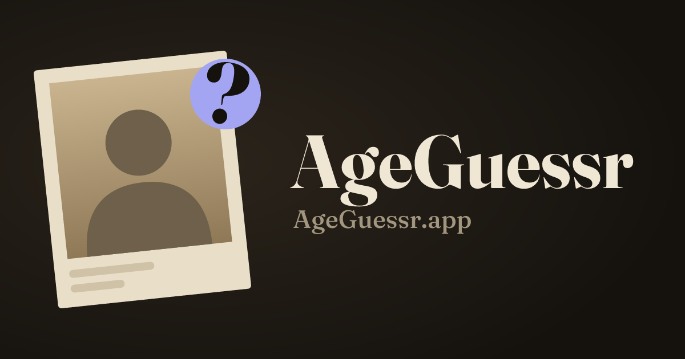
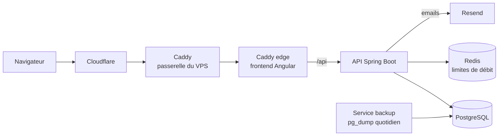

<div align="center">



# AgeGuessr

**Devinez l'âge des personnalités sur leur photo. Un indice d'époque pour vous rattraper.**

[ageguessr.app](https://ageguessr.app) · jeu quotidien · français et anglais


</div>

---

## Le jeu

Chaque jour, trois photos de personnalités. Pour chacune, il faut deviner **l'âge de la
personne au moment de la photo**.

1. **Premier essai** : le jeu répond « plus vieux » ou « plus jeune », avec l'écart
   (1 à 5 ans, 6 à 15 ans, plus de 15 ans).
2. **Trois indices au choix**, parmi musique, cinéma, sport, sciences, littérature,
   actualité et célébrités. Chaque indice raconte un événement d'il y a autant d'années
   que l'âge de la personne sur la photo, sans jamais donner l'année.
3. **Second essai**, puis la révélation : la personne, sa date de naissance, le crédit
   de la photo et les points. Chaque essai vaut jusqu'à 500 points selon l'écart, soit
   1 000 par photo ; un premier essai exact rapporte directement les 1 000.

Autour de la partie du jour :

- **Calendrier** : rejouer n'importe quel jour passé.
- **Séries libres** de 5, 10 ou 20 photos, à partager en **défi** par un code, avec un
  classement des participants.
- **Amis** : demandes d'amitié, résultats du jour des amis, classement.
- **Jouable sans compte** : les parties d'un invité sont rattachées à son compte s'il en
  crée un.
- **Partage** du résultat sous forme de grille, sans rien dévoiler.
- **Signalement** d'une photo ou d'un indice douteux, traité en modération.

## Fonctionnement

### Le contenu

- **Personnes** : ingérées depuis **Wikidata** (via QLever) avec une date de naissance
  vérifiée, et leurs photos depuis **Wikimedia Commons** (licences libres seulement).
  Une photo n'est retenue que si sa date déclarée est corroborée par l'EXIF de
  l'appareil, et jamais si la personne y est mineure.
- **Modération** : chaque photo passe par une file de validation dans l'espace
  d'administration avant d'entrer dans le jeu. Les joueurs peuvent signaler une photo ou
  un indice douteux.
- **Anti-triche** : les images sont ré-encodées sans métadonnées et servies sous un
  identifiant opaque. Impossible de retrouver la source par le nom de fichier ou par
  l'empreinte.
- **Indices** : plus de 10 000 événements tirés de Wikipédia et Wikidata, classés par
  catégorie et par année.

### L'architecture



- **Vertical Slice Architecture** : un package par domaine (`auth`, `game`, `friends`,
  `people`, `hints`), puis un package par cas d'usage (`SubmitFirstGuess`,
  `GetCalendar`…). Environ 60 cas d'usage, chacun avec son controller, son handler et
  ses DTO.
- **CQRS sans médiateur** : handlers injectés directement, validation Jakarta Bean
  Validation, erreurs métier centralisées dans un `@RestControllerAdvice`.
- **Règles d'architecture vérifiées par ArchUnit** : isolation des slices, aucun appel
  réseau sortant pendant une requête de jeu.
- **Frontend Angular** en composants standalone, Signals et services (pas de NgRx),
  Tailwind CSS, deux builds localisées (`/en/`, `/fr/`) et un thème clair ou sombre.

### Sécurité et données personnelles

- **Authentification** : JWT bearer d'une heure, et refresh token rotatif de 90 jours
  dans un cookie `HttpOnly`. Verrouillage après des échecs répétés, limites de débit par IP
  (Redis).
- **RGPD** : export des données personnelles en JSON, suppression de compte confirmée
  par email, purge automatique des comptes non vérifiés et inactifs, durées de
  conservation annoncées dans la politique de confidentialité.
- **Aucun secret dans le dépôt** : tout passe par l'environnement GitHub `production`.

## Stack

| Domaine | Technologies |
|---|---|
| Backend | Java 25, Spring Boot 4, Spring Security (OAuth2 Resource Server), Spring Data JPA, Flyway, PostgreSQL 18, Redis 8 |
| Frontend | Angular 22, TypeScript, Signals, Tailwind CSS 4, Angular i18n |
| Tests | JUnit 5, Mockito, Testcontainers, ArchUnit, PIT, Vitest, Playwright |
| Infra | Docker, GitHub Actions, GHCR, VPS OVH, Caddy, Cloudflare |
| Services | Resend (emails), UptimeRobot (surveillance) |

## Qualité

| Catégorie | Outil | Volume |
|---|---|---|
| Unitaire, intégration, fonctionnel, architecture (backend) | JUnit 5, Testcontainers, ArchUnit | ~1 300 tests |
| Unitaire (frontend) | Vitest | ~480 tests |
| Interface et parcours utilisateur | Playwright, en anglais et en français | 34 specs |
| Mutation | PIT | sur les PR de release |

- **CI GitHub Actions** sur chaque PR : tests backend et frontend, Playwright, test du
  script de sauvegarde (dump puis restauration dans un vrai PostgreSQL). Tests de
  mutation sur les PR de release.
- **Hook pre-push** qui lance la suite rapide avant chaque envoi.
- **Déploiement continu** : chaque merge sur `main` construit les images, les publie
  sur GHCR, les déploie sur le VPS et lance un smoke test.
- **Exploitation** : dump quotidien de la base (30 jours au plus), logs bornés,
  `/api/health` et `/api/health/backup` surveillés par UptimeRobot, emails d'alerte sur
  les erreurs du backend.

## Développement local

Prérequis : Java 25, Node 24 et pnpm, Docker.

```bash
cp .env.example .env                      # puis renseigner JWT_SECRET (openssl rand -base64 32)
docker compose up -d                      # PostgreSQL (5433) et Redis (6380)

cd ageguessr-api
export $(grep -v '^#' ../.env | xargs)
./mvnw spring-boot:run                    # API sur http://localhost:8080

cd ../frontend
pnpm install
pnpm start                                # http://localhost:4200
```

### Tests

```bash
git config core.hooksPath .githooks        # une fois : hook pre-push

cd ageguessr-api && ./mvnw test            # backend (Docker requis pour Testcontainers)
cd frontend && pnpm test                   # frontend
cd frontend && pnpm test:e2e               # Playwright
```

Avant le premier lancement de Playwright, il faut installer le navigateur et ses
bibliothèques système : `cd frontend && pnpm exec playwright install --with-deps chromium`
(demande `sudo`). La CI le fait déjà.

## Structure

```
ageguessr-api/          API Spring Boot
  src/main/java/app/ageguessr/
    features/<domaine>/<CasDUsage>/   un package par cas d'usage
    shared/                           transversal (sécurité, emails, limites de débit…)
    config/                           configuration Spring
  src/main/resources/db/migration/    migrations Flyway
frontend/               application Angular
  src/app/features/                   un dossier par domaine
  src/locale/messages.fr.xlf          traductions
  e2e/                                specs Playwright
deploy/backup/          sauvegarde de la base et son test
docs/                   décisions d'architecture et de design, stratégie de tests, roadmap
plans/                  un plan par fonctionnalité
```

## Documentation

- [Décisions d'architecture](docs/decisions/architecture.md) : chaque choix technique,
  avec sa raison et ses limites.
- [Décisions de design](docs/decisions/design.md) : direction visuelle, typographie,
  vocabulaire.
- [Stratégie de tests](docs/testing-strategy.md)
- [Roadmap](docs/roadmap.md)

## Méthode de développement

Le projet est développé de façon agentique avec Claude Code : conception, plans de
fonctionnalité (`plans/`) et arbitrages par le mainteneur ; implémentation par l'agent ;
revues systématiques par deux agents dédiés, l'un pour l'architecture, l'autre pour la
sécurité et le RGPD (`.claude/agents/`). Les règles du projet sont dans
[`CLAUDE.md`](CLAUDE.md).

## Licence

Code sous licence MIT, voir [LICENSE](LICENSE). Les indices de
`ageguessr-api/src/main/resources/hints/` viennent de Wikipédia (CC BY-SA 4.0) et de
Wikidata (CC0) : voir le `README.md` de ce dossier. Les photos viennent de Wikimedia
Commons, chacune créditée dans le jeu avec son auteur et sa licence.
